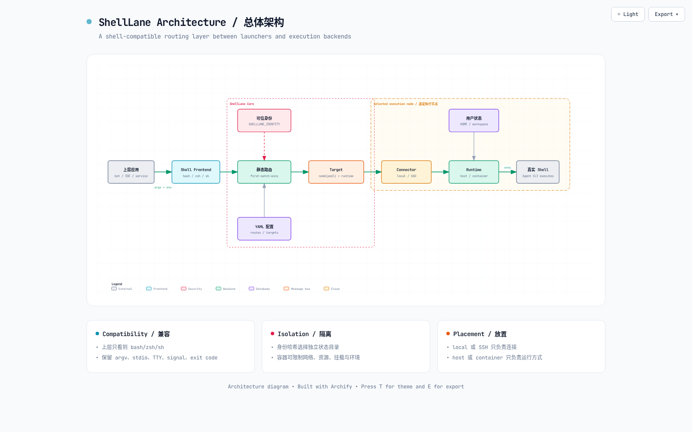
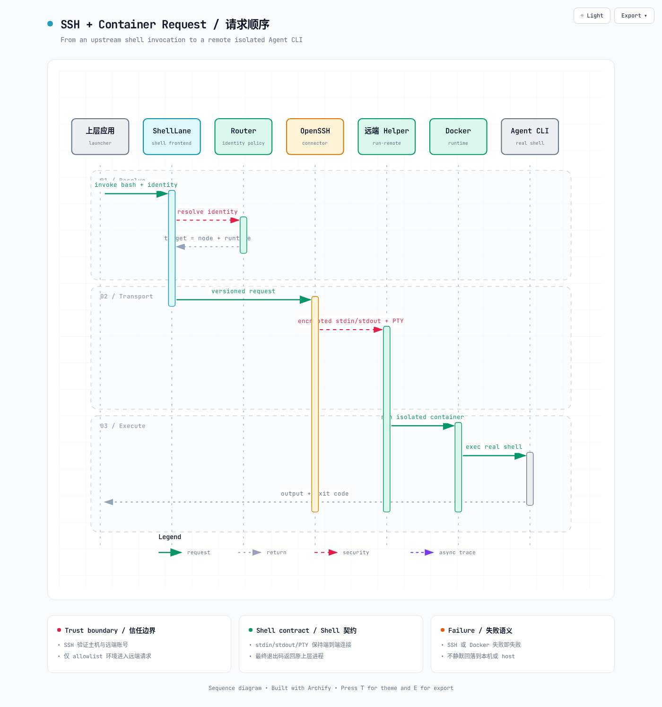

# ShellLane

ShellLane 是一个兼容 `bash`、`zsh`、`sh` 调用方式的执行路由层。上层应用仍然像调用
系统 Shell 一样启动 Agent CLI，ShellLane 在中间根据可信用户身份，决定去哪个机器、
使用 host 还是容器运行，以及挂载哪一份用户状态。

## 为什么要做

现在很多上层应用直接通过系统命令行调用 Codex、Claude Code（CC）、Trae Agent
或其他 Agent CLI。这种方式足够通用，不需要为每一种 Agent 写 SDK 适配器，但也带来
几个问题：

- 所有请求默认绑定在上层应用所在机器；
- 不同用户容易共享 HOME、配置、凭据、缓存和工作目录；
- 团队成员希望使用自己的开发机，普通用户又可能没有开发机；
- 容器、SSH、物理机等执行方式会侵入上层应用代码；
- 上层应用一旦自己处理身份、路由、SSH、Docker，就逐渐变成复杂的调度平台。

ShellLane 只解决中间这一层：

```text
上层应用
  → 像往常一样调用 bash/zsh/sh
  → ShellLane 根据身份选择 Target
  → local 或 SSH
  → host 或 container
  → Codex / CC / Trae / 其他 Agent CLI
```

上层应用不用知道 Docker、SSH 或用户目录怎么组织；Agent CLI 也仍然只看到普通
Shell 环境。ShellLane 不处理聊天消息，不理解 prompt，也不是 Bot 网关或 Agent 框架。



## 四种直接可用的运行方式

| 连接方式 | 运行方式 | 典型用途 | 配置 |
| --- | --- | --- | --- |
| local | host | 管理员、单机开发 | [`local-host.yaml`](configs/local-host.yaml) |
| local | container | 普通用户本机容器隔离 | [`local-docker.yaml`](configs/local-docker.yaml) |
| SSH | host | 团队成员自己的开发机 | [`ssh-host.yaml`](configs/ssh-host.yaml) |
| SSH | container | 远端工作节点容器隔离 | [`ssh-docker.yaml`](configs/ssh-docker.yaml) |

管理员、团队成员、普通用户混合路由见
[`mixed.yaml`](configs/mixed.yaml)。

## 三分钟体验

```bash
sudo make install
export SHELLLANE_IDENTITY="user@example"
/usr/local/lib/shelllane/bash -lc 'echo "HOME=$HOME"; pwd'
```

`make install` 会完成构建、安装二进制、创建 `bash`/`zsh`/`sh` 三个 wrapper 软链，
准备状态和日志目录，并把全部 `configs/*.yaml` 示例复制到用户的
`$HOME/.config/shelllane/`。若 `config.yaml` 尚不存在，会用 `local-host.yaml`
初始化；重复安装不会覆盖用户已经修改的主配置。通过 `sudo` 执行时读取 `SUDO_USER`
及该账号的 HOME，不会把配置装到 `/root`。安装位置、运行账号和配置目录可以覆盖：

```bash
sudo make install PREFIX=/opt/shelllane RUNTIME_USER=agent
make install DESTDIR=/tmp/package-root RUNTIME_USER="$USER"
sudo make install CONFIG_DIR=/custom/xdg/shelllane
```

`make uninstall` 只删除二进制和软链，故意保留配置、用户状态及日志，避免误删数据。

在接入上层应用前先检查配置和路由：

```bash
shelllane config check --config configs/mixed.yaml
shelllane route test --config configs/mixed.yaml --identity admin@example
shelllane route test --config configs/mixed.yaml --identity developer@example
shelllane route test --config configs/mixed.yaml --identity any-normal-user
```

## 仓库模板与真实配置路径

这两个目录用途不同：

```text
代码仓库：<repo>/configs/*.yaml
           只保存 local-host、SSH、Docker、mixed 等模板

真实运行：$XDG_CONFIG_HOME/shelllane/config.yaml
默认展开：$HOME/.config/shelllane/config.yaml
系统服务：/etc/shelllane/config.yaml
```

例如用户 `ammend` 未设置 `XDG_CONFIG_HOME` 时，默认运行配置是：

```text
/home/ammend/.config/shelllane/config.yaml
```

不是 `/home/ammend/configs/local-host.yaml`。后者只有在仓库正好位于
`/home/ammend` 时才是一个模板文件。

## 映射上层已有的身份变量

上层不需要专门设置 `SHELLLANE_IDENTITY`。如果 launcher 已经提供经过认证的身份变量，
在 ShellLane 配置中完成映射即可：

```yaml
identity:
  env: SHELLLANE_IDENTITY
  envMap:
    SHELLLANE_IDENTITY: "$BOTMUX_USER_ID"
  argvEnvFallback: true
  required: true
```

例如上游进程本来就有 `BOTMUX_USER_ID=ou_xxx`，ShellLane 会把它解析为内部统一身份
`SHELLLANE_IDENTITY=ou_xxx`，用于路由和隔离。这个映射只发生在 ShellLane 内部，不会
要求上游动态增加环境变量，也不会修改真实 Shell 收到的环境。若 canonical 变量和映射
来源同时存在但值不同，ShellLane 会以 `identity_conflict` 拒绝执行。

如果 launcher 把自己已有的变量追加在 Shell 可执行文件后，同一个映射也会生效：

```bash
/usr/local/lib/shelllane/bash BOTMUX_USER_ID=alice -lc 'pwd'
```

启用 `argvEnvFallback: true` 后，ShellLane 读取并消费
`BOTMUX_USER_ID=alice`；真实 Bash 的 argv 只收到 `bash -lc 'pwd'`，同时其环境中仍有
原值 `BOTMUX_USER_ID=alice`。ShellLane 不删除或改写已有的 `BOTMUX_USER_ID`、
`SHELLLANE_IDENTITY` 或其他用户环境变量。

## 上层把身份变量放在 Bash 后面时（兼容模式）

如果上层不是设置进程环境，而是在 Shell 可执行文件后追加变量：

```text
/usr/local/lib/shelllane/bash SHELLLANE_IDENTITY=user@example -lc 'codex ...'
```

这是兼容旧 launcher 的备选能力。配置中开启 `identity.argvEnvFallback: true`。
ShellLane 会消费
`SHELLLANE_IDENTITY=...`，将同名同值恢复到真实 Shell 的环境，再把剩余 argv 原样交给
真实 Bash；env 与 argv 同时存在但
值不一致时会拒绝执行。

## 身份与隔离

ShellLane 从配置指定或映射的、已经认证过的上游环境变量读取用户标识。ShellLane 使用原始值做
精确路由。用户目录默认使用可读的原始身份，审计仍只记录 SHA-256：

```text
/var/lib/shelllane/users/<identity>/
├── shared/
│   ├── config/       # 跨 runtime 复用的工具配置
│   ├── credentials/  # 需要显式挂载的凭据
│   ├── data/
│   ├── state/
│   └── workspace/
├── profiles/<profile>/
│   ├── home/
│   └── cache/
└── tmp/
```

目录命名可以配置为 `plain`（默认、可读）、`base64url`（可逆且路径安全）或
`hash`（不可逆、隐私最好）：

```yaml
state:
  root: /var/lib/shelllane/users
  identityNaming: plain
```

`plain` 遇到 `/`、`\\`、`.`、`..` 或超过 255 字节的身份会拒绝执行；此时选
`base64url` 或 `hash`。

少量例外用户可以显式配置；无法枚举的大量普通用户由最后一条默认路由覆盖。两台或
多台工作机组成 NodePool 时，Rendezvous Hash 让同一身份稳定落到同一节点。

## 图解



- [总体架构大图](docs/diagrams/shelllane-architecture.png)
- [SSH + Docker 顺序大图](docs/diagrams/ssh-container-sequence.png)
- [架构与请求流中文说明](docs/zh-CN/architecture.md)

PNG 在 GitHub 页面直接显示；同目录保留 Archify 交互 HTML，clone 后打开可切换
深浅色并导出 PNG、JPEG、WebP、SVG。

## 文档导航

- [按场景选择配置](configs/README.zh-CN.md)
- [中文配置教程](docs/zh-CN/configuration.md)
- [完整字段参考（英文）](docs/configuration.md)
- [中文安全模型](docs/zh-CN/security.md)
- [完整安全模型（英文）](docs/security.md)
- [Shell 兼容边界](docs/compatibility.md)

## 接入 botmux 等上层应用

botmux 只是一个用途示例。把某个 Bot 的 `launchShell` 指向
`/usr/local/lib/shelllane/bash`，再在 ShellLane 的 `identity.envMap` 中把
`BOTMUX_USER_ID` 映射为统一身份即可；botmux 无需动态设置新变量。Codex、CC、Trae
或其他 CLI 的启动参数不需要由
ShellLane 理解。

IDE 服务、Web Terminal、内部任务平台和 CI Runner 也可以用相同方式接入。

## 验收

```bash
make check               # unit / race / vet / format
make configs-check       # 仓库内所有示例配置
make integration         # 真实 local + host
make docker-integration  # 真实 local + Docker
make ssh-integration     # 临时 localhost sshd，覆盖 SSH + host/container
```

Apache-2.0，见 [LICENSE](LICENSE)。
